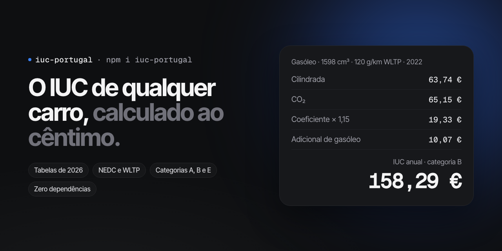

# iuc-portugal



[](https://www.npmjs.com/package/iuc-portugal)
[](https://github.com/rsoaresdev/iuc-portugal/actions/workflows/ci.yml)
[](https://bundlephobia.com/package/iuc-portugal)
[](LICENSE)

**Calculadora do IUC (Imposto Único de Circulação) em JavaScript e TypeScript.** Calcula o IUC de um carro ou de uma mota em Portugal, ao cêntimo, com as tabelas em vigor em 2026: categorias A, B e E, CO2 em NEDC ou WLTP, taxa adicional de CO2, coeficiente do ano da matrícula e adicional de gasóleo. Sem dependências, com tipos TypeScript, em ESM e CommonJS: funciona no browser, em Node.js, em React Native, no Jest e em edge runtimes.

[English below](#english)

```bash
npm install iuc-portugal
```

```ts
import { computeIuc } from "iuc-portugal";

const iuc = computeIuc({
	vehicle: "car",
	year: 2019, // ano da primeira matrícula em Portugal ou na UE
	month: 3,
	fuel: "petrol",
	cc: 1199, // cilindrada em cm3
	co2: 110, // g/km
	cycle: "nedc",
});

if (iuc.status === "due") {
	console.log(iuc.totalCents / 100); // 111.46
}
```

## Porquê

Quem faz uma app, um site de carros ou um stand online em Portugal acaba por ler o Código do IUC e reescrever as tabelas à mão. Este pacote faz isso uma vez, com testes contra os exemplos publicados pela Autoridade Tributária e pela DECO:

- **Ao cêntimo.** Todo o cálculo é feito em cêntimos inteiros, e o coeficiente em centésimas inteiras. Nenhum arredondamento de vírgula flutuante decide um cêntimo.
- **Explica o valor.** O resultado traz cada parcela (cilindrada, CO2, taxa adicional, coeficiente, gasóleo), pronta para mostrar ao utilizador.
- **Diz quando não há imposto.** Elétricos isentos, carros antes de 1981 e motas antes de 1992 vêm como estados próprios, não como zero.
- **Tipado.** O resultado é uma união discriminada: o TypeScript obriga a tratar cada caso.

## API

### `computeIuc(input): IucResult`

| Campo     | Tipo                                            | Notas                                                                         |
| --------- | ----------------------------------------------- | ----------------------------------------------------------------------------- |
| `vehicle` | `"car" \| "motorcycle"`                         | Ligeiro de passageiros ou motociclo.                                          |
| `year`    | `number`                                        | Ano da primeira matrícula em Portugal ou na UE/EEE.                           |
| `month`   | `number`                                        | Mês da primeira matrícula, de 1 a 12. Decide entre a categoria A e B em 2007. |
| `fuel`    | `"petrol" \| "diesel" \| "other" \| "electric"` | `other` é qualquer outro combustível, por exemplo GPL ou gás natural.      |
| `cc`      | `number`                                        | Cilindrada em cm3.                                                            |
| `co2`     | `number \| null`                                | Emissões de CO2 em g/km. Só é obrigatório na categoria B.                     |
| `cycle`   | `"nedc" \| "wltp"`                              | Ciclo de homologação do valor de CO2.                                         |

O resultado é um destes:

```ts
{ status: "due", category: "A" | "B" | "E", totalCents, lines, belowMinimum }
{ status: "needs", field: "co2" }            // categoria B sem valor de CO2
{ status: "exempt", reason: "electric" }
{ status: "outside", reason: "carBefore1981" | "motorcycleBefore1992" }
```

`belowMinimum` é `true` quando o total fica abaixo de 10 euros, que não é cobrado (artigo 16.º do CIUC).

Uma entrada inválida (mês 13, cilindrada negativa, combustível desconhecido) lança um `RangeError` ou um `TypeError`, em vez de devolver um valor errado.

### `iucSchedule(totalCents)`

A partir de 2027 o IUC passa a ser pago por ano civil, e o número de prestações depende do total que o proprietário paga por todos os veículos. Passa a soma de todos os veículos:

```ts
iucSchedule(42000); // { y2027: "october", y2028: "aprilOctober" }
```

### `iucCategory({ vehicle, year, month })`

Devolve `"A"`, `"B"` ou `"E"`. A categoria B começa a 1 de julho de 2007.

### `RATES_YEAR` e `RATES_SOURCE`

O ano das taxas (`2026`) e as leis de onde vêm. Úteis para uma nota "taxas de 2026" no teu site, ou para um aviso quando o ano mudar e o pacote ainda não tiver sido atualizado:

```ts
import { RATES_YEAR } from "iuc-portugal";

if (new Date().getFullYear() > RATES_YEAR) {
	console.warn(`As taxas do IUC são de ${RATES_YEAR}.`);
}
```

### `tables`

As tabelas do código, em cêntimos, para quem queira mostrá-las ou fazer contas próprias. Estão congeladas: não podem ser alteradas em tempo de execução.

## O que fica de fora

De propósito: veículos de mercadorias (categorias C e D), isenções que dependem do proprietário (deficiência, IPSS, táxis) e as regiões autónomas dos Açores e da Madeira, onde o valor de CO2 é o do ISV.

## Fontes

- Código do IUC, na redação da Lei n.º 82/2023, sem alterações nos Orçamentos do Estado de 2025 e 2026.
- Adicional de IUC sobre o gasóleo: Lei n.º 82-B/2014, artigo 216.º, mantido pela Lei n.º 73-A/2025, artigo 94.º.
- Confrontado com o código consolidado da Autoridade Tributária a 2 de outubro de 2026.

Este pacote dá uma estimativa. O valor oficial é o que aparece no Portal das Finanças.

---

## English

**Portuguese car tax (IUC, Imposto Único de Circulação) calculator for JavaScript and TypeScript.** It works out the yearly road tax of a car or motorcycle registered in Portugal, to the cent, with the 2026 rates: categories A, B and E, NEDC and WLTP CO2 bands, the extra CO2 tax, the registration-year coefficient and the diesel surcharge. Zero dependencies, TypeScript types, ESM and CommonJS. Runs in browsers, Node.js, React Native, Jest and edge runtimes.

```ts
import { computeIuc } from "iuc-portugal";

computeIuc({
	vehicle: "car",
	year: 2022,
	month: 5,
	fuel: "diesel",
	cc: 1598,
	co2: 120,
	cycle: "wltp",
});
// {
//   status: "due",
//   category: "B",
//   totalCents: 15829,
//   belowMinimum: false,
//   lines: [
//     { key: "engine", cents: 6374 },
//     { key: "co2", cents: 6515 },
//     { key: "coefficient", cents: 1933, factor: 1.15 },
//     { key: "diesel", cents: 1007 },
//   ],
// }
```

Every amount is an integer number of cents, so no floating point rounding ever changes a cent. The API table above applies as is: `vehicle`, first registration `year` and `month`, `fuel`, engine size `cc` in cm3, `co2` in g/km (needed for category B only) and the CO2 test `cycle`.

`RATES_YEAR` (2026) and `RATES_SOURCE` say which year's rates and which laws the tables hold.

The result is an estimate. The official amount is the one on the Portuguese tax authority's portal (Portal das Finanças).

## License

[MIT](LICENSE)
